# Mobile layout repair

The published redesign could overflow on phones when text was enlarged. The intro
heading was forced onto one line, grid items retained their intrinsic minimum
widths, and navigation could not wrap. Larger text also exposed the hidden skip
link above the page.

The fix allows headings and grid content to reflow, gives navigation responsive
columns, keeps the skip link fully offscreen until focused, and uses a fluid
heading scale on narrow screens. Mobile text sizing stays consistent across
orientation changes while browser zoom and larger user text settings remain
available. CSS and scripts include a build revision in their URLs so a browser
cannot combine new HTML with the preceding deployment’s cached assets.

Screenshots below compare the exact published page with the repaired build using
an iPhone SE profile (320 CSS pixels), in Chromium and WebKit. Enlarged-text
captures use a 200% root text size. Desktop captures confirm the wider layout.

## WebKit (Safari engine)

| View | Before | After |
| --- | --- | --- |
| Normal intro |  |  |
| Intro at 200% text |  | 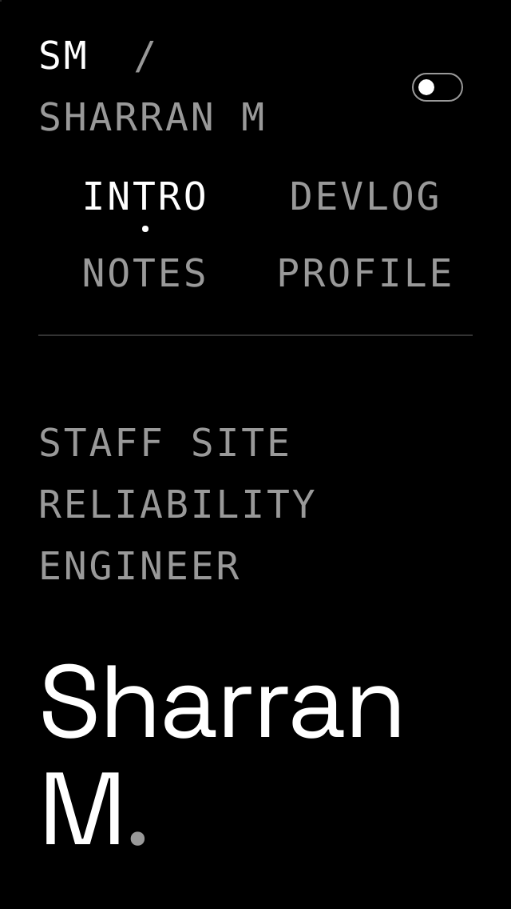 |
| Profile at 200% text | 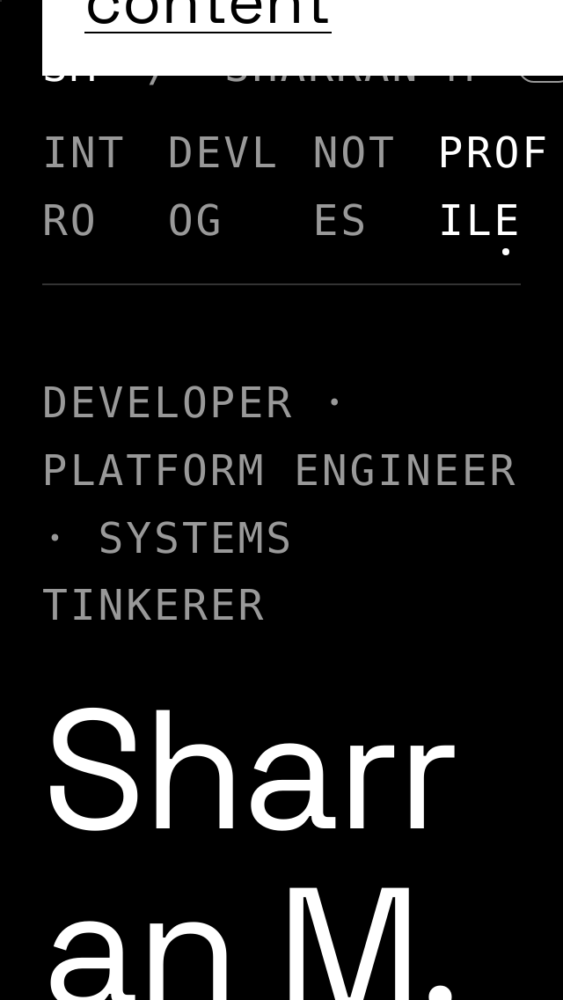 | 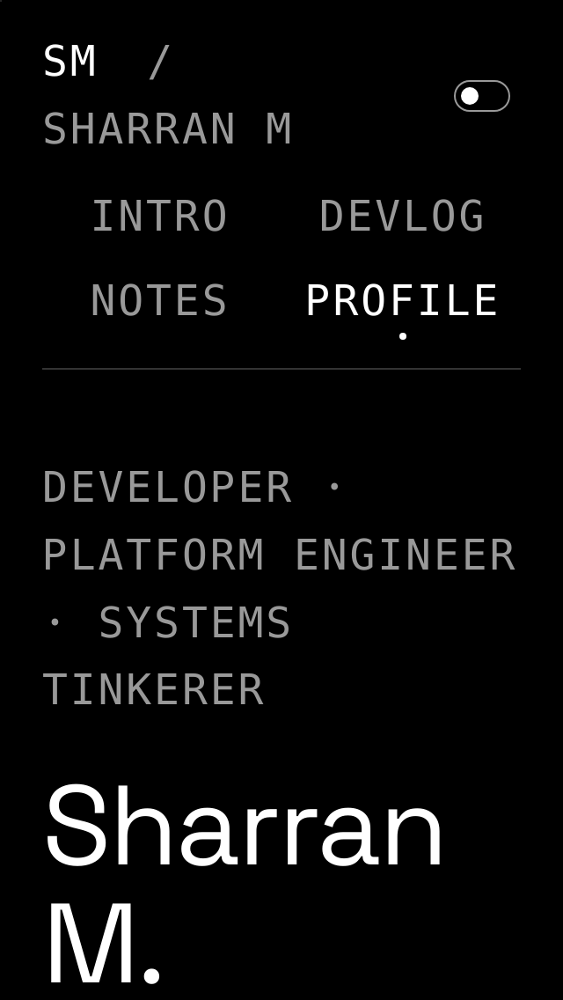 |

## Chromium

| View | Before | After |
| --- | --- | --- |
| Normal intro | 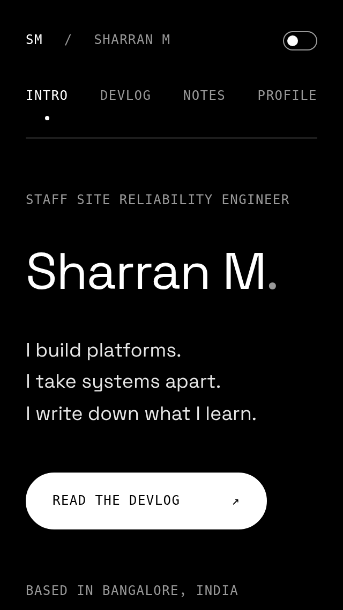 | 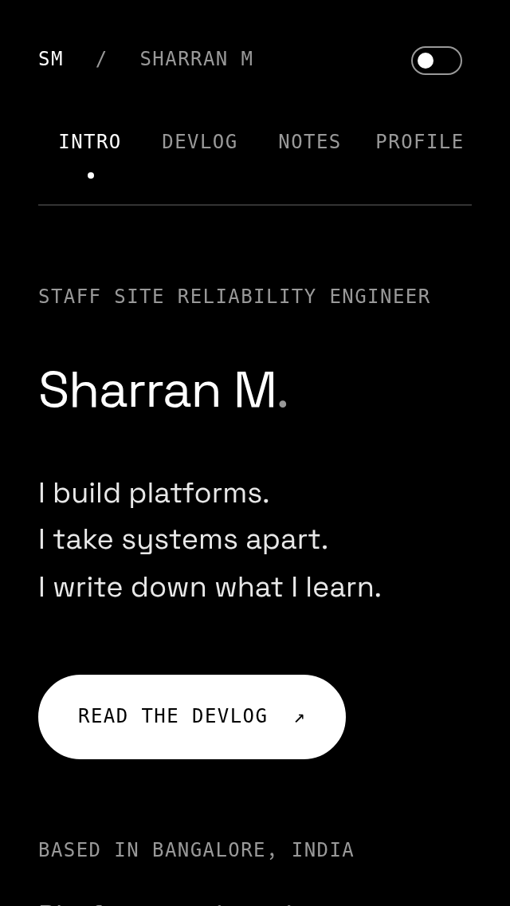 |
| Intro at 200% text | 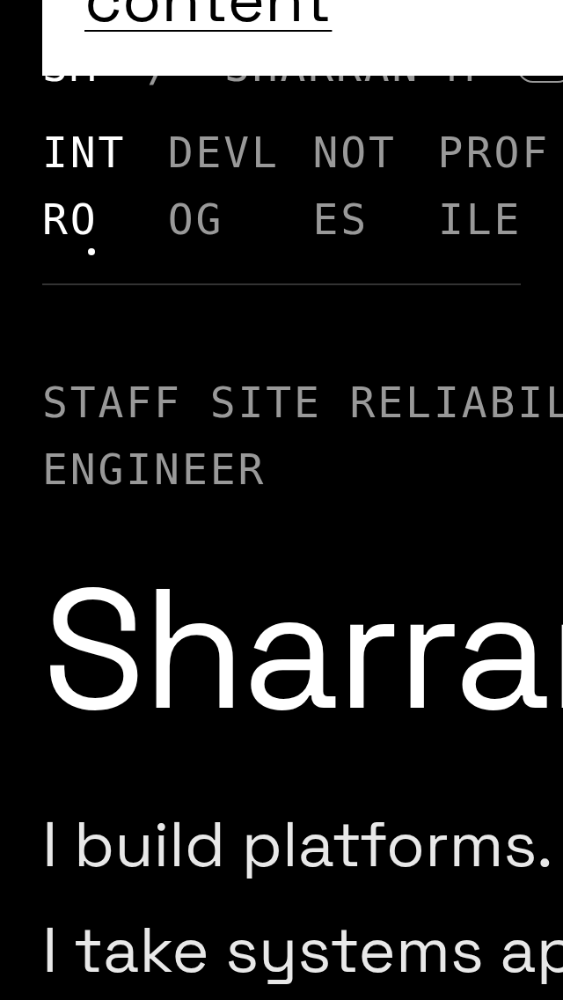 |  |
| Profile at 200% text | 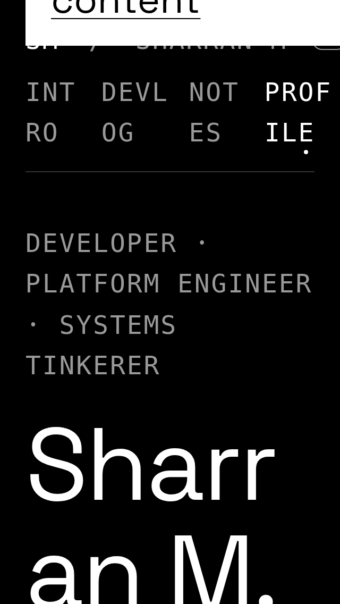 | 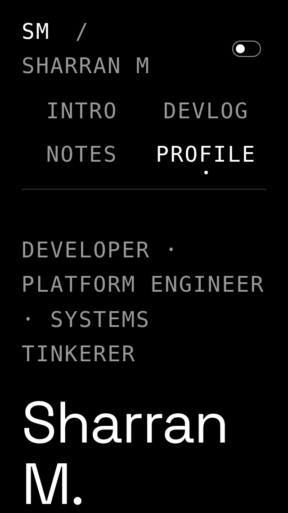 |

## Desktop

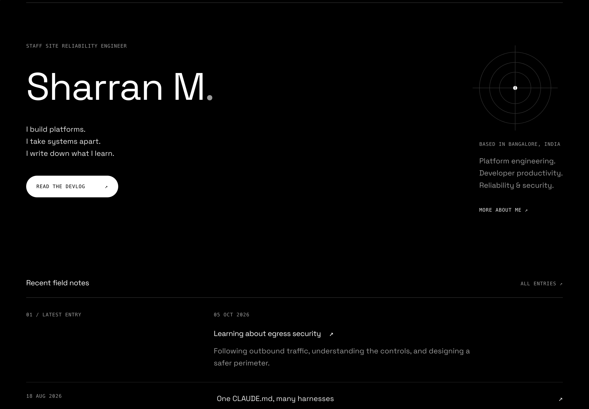
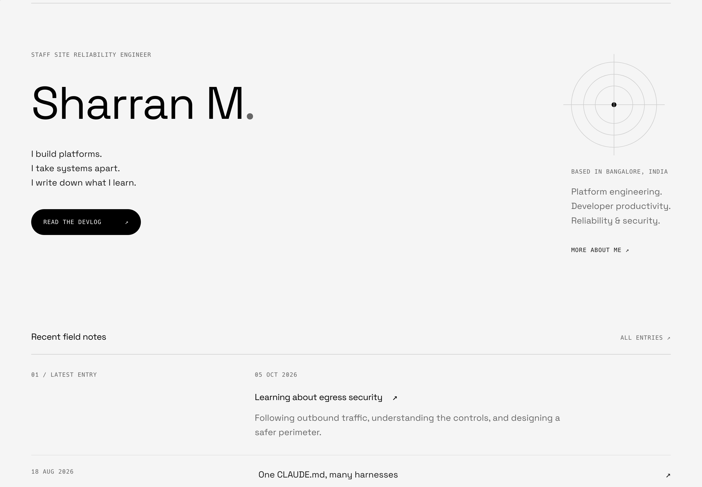
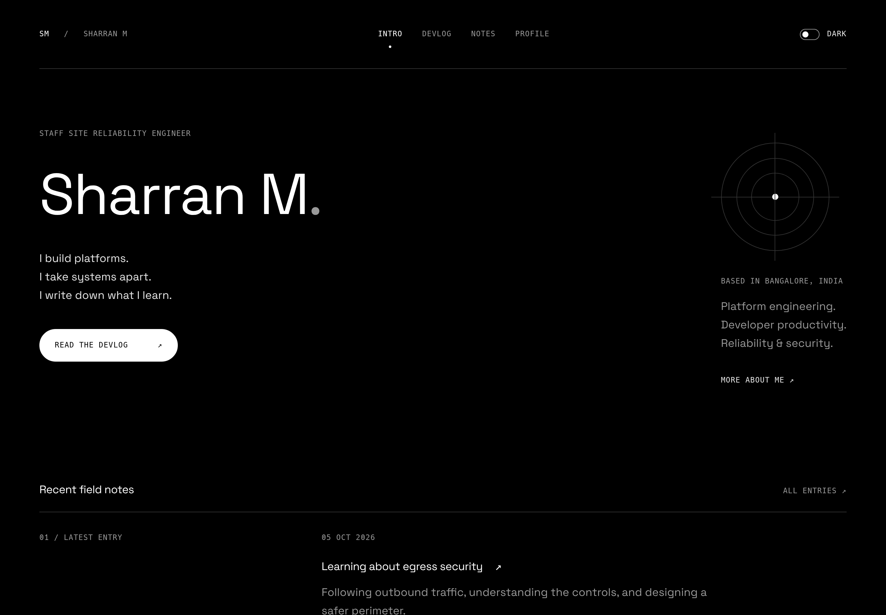
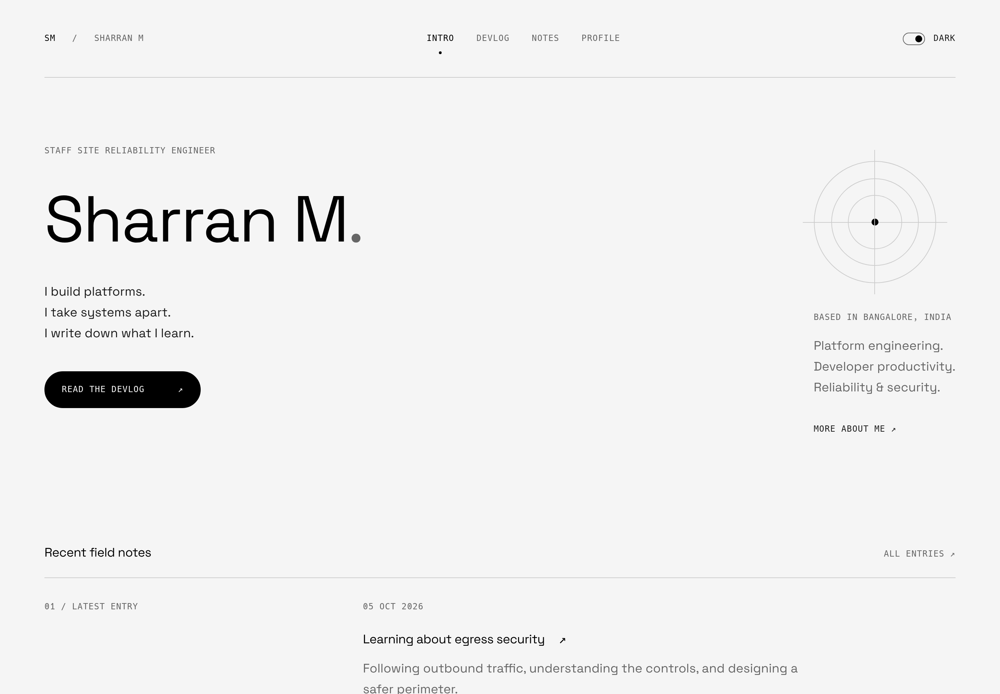

## Verification

- Jekyll build passes with the existing lockfile unchanged.
- 384 layout cases: all 16 pages, portrait (320px) and landscape (667px),
  dark/light, 100%/150%/200% text, Chromium and WebKit. No horizontal page overflow.
- Keyboard skip navigation and theme persistence pass in both engines.
- Final header and asset-version smoke checks pass at normal and enlarged text.

The engines use emulated phone settings; these are browser-engine checks, not a
claim of testing on physical iOS or Android hardware.
